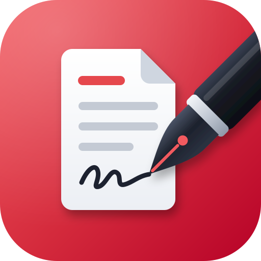

# PdfCraft app icon



**PatroneOS edition.** This fork replaces upstream's engraved lion, whose line work blurs below 48 px, with a
picture of what the app does that stays clear down to 16 px.

**Subject:** a white page with a folded corner, a red heading and lines of text, being signed by a dark
fountain-pen nib whose barrel comes in from the top-right corner.

**Style:** flat shapes with soft gradients and drop shadows, in the manner of PatroneOS's own icons (a white
page with a cool-grey fold, as in its PDF and Documents icons).

**Palette**

| Colour | Hex | Used for |
|---|---|---|
| PdfCraft red | `#f25a5f` to `#b70228` | the full-bleed field (diagonal), the nib's slit and breather hole |
| PatroneOS PDF red | `#e5484d` | the page's heading line |
| Page | `#ffffff` to `#eceff4`, fold `#cfd6e0` | the page |
| Text grey | `#c4cad4` | the page's lines of text |
| Ink | `#1d2230`, barrel `#3a4254` to `#0c0e13` | the signature, the nib and the barrel |

**Tile:** `viewBox="0 0 512 512"`, a rounded square with `rx=112` that clips everything. Windows and Linux
icons use the full-bleed tile. macOS icons put it on Apple's grid (an 824 px body centred on a transparent
1024 px canvas).

**Small sizes:** `pdfcraft-tiny.svg` is the same picture for 16-32 px: no signature, heading or highlights,
two heavier lines of text, and a bigger page and pen.

**Provenance:** drawn by hand as SVG for this fork. Licence: [LICENSE.txt](LICENSE.txt) (`MIT OR Apache-2.0`,
like the repo).

## Files

| File | What it is |
|---|---|
| `pdfcraft.svg` | the master vector; every PNG, `.ico` and `.icns` is rendered from it (or from `pdfcraft-tiny.svg` up to 32 px); also the mark in the About dialog and on the home screen |
| `pdfcraft-tiny.svg` | the master with less detail, for 16-32 px |
| `pdfcraft-small.svg` | a copy of the master for places that link to it, such as this README |
| `pdfcraft-1024.png` | 1024 px on Apple's grid; also the runtime Dock icon on macOS |
| `pdfcraft.icns` | macOS icon (16–1024 px) |
| `pdfcraft.ico` | Windows icon (16–256 px), embedded in `pdfcraft.exe` by `apps/pdfcraft/build.rs` |
| `pdfcraft-document.svg` | Windows PDF file icon master: a Lucide document outline, red badge and outlined PDF lettering; no font dependency |
| `pdfcraft-document.ico` | Windows PDF file icon (16–256 px), embedded as resource 2 in `pdfcraft.exe` |
| `hicolor/<n>x<n>/apps/org.patrone.Pdf.png` | Linux hicolor theme, 16–512 px; the 256 px one is the runtime icon on Windows and Linux |
| `hicolor/scalable/apps/org.patrone.Pdf.svg` | Linux scalable icon (copy of the master) |

Where it shows: `apps/pdfcraft/src/main.rs` sets the window icon (Dock, taskbar, Alt-Tab, launcher) and the
Wayland app id `org.patrone.Pdf`; `packaging/linux/org.patrone.Pdf.desktop` names the
hicolor icon.

Windows PDF files use resource 2 (`"pdfcraft.exe",-2`) when PdfCraft is chosen as the default
reader; the app keeps resource 1. The document outline is adapted from Lucide `file-text`
1.49.0 (ISC); its badge and outlined lettering are original (`MIT OR Apache-2.0`), covered by
[LICENSE-document.txt](LICENSE-document.txt). Both icons are embedded, requiring no runtime
sidecar. This provides a file type icon; first-page thumbnails still need a thumbnail provider.

## Regenerate

```sh
python patrone/icons.py   # the app icon; needs resvg (or RESVG=<path>) and Python 3, on any system
cargo xtask assets        # then update the sha256 values in ATTRIBUTION.toml and run with --write
```

`packaging/icons.sh` is upstream's script. Use it only for the Windows PDF document icon: it renders every
size of the app icon from the master alone and needs macOS for the `.icns`.
